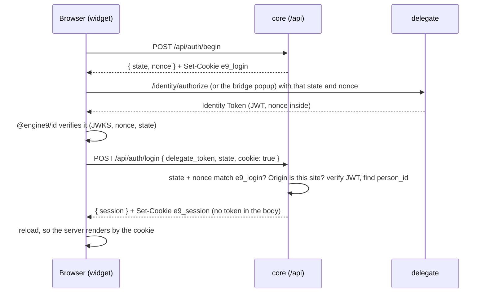
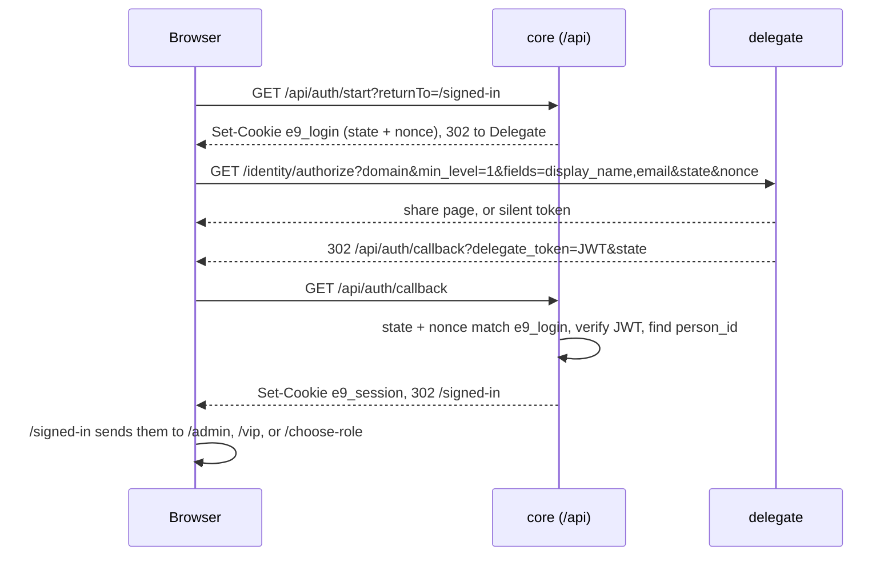

# Festival demo — identity flow

The demo is an Astro + Cloudflare Worker Site that embeds `@engine9/core`
and `@engine9/id`. Protocol: [`id/docs/protocol.md`](../../id/docs/protocol.md).

**This is the recommended way to sign people in with core and Delegate.**
Every step below is core's or `@engine9/id`'s. The site writes no sign-in
route and keeps no session of its own; the only site code is configuration,
the 403 page, and the demo-only role picker. The general guide is core's
[Sign-in on a site](../../core/docs/sign-in.md).

## How visitors log in

The [`@engine9/id` login widget](../../id/README.md#with-a-server-session) in
the header is the main way to interact with Delegate. One **Login** button
shows the session's email and role. Its dialog runs every Delegate step:
Log in with Google, Switch email, Change role (VIP or Admin), and Log out.

The widget runs with `core: { apiUrl: "/api", publicApiKey, session:
"cookie" }` (`BROWSER_CORE` in `src/lib/engine9.ts`). That one setting is what
makes it the recommended setup: core sets its HttpOnly `e9_session` cookie
from the widget's sign-in, and that cookie is what the server gate reads.

In-page log in links (Schedule, Tickets, Register, and the notices on
`/login`) carry `data-open-login`; the layout opens the same dialog for them.
Their `href` (`/login`) is the no-JavaScript fallback: a plain link to
core's `/api/auth/start`, which ends in the same cookie.

`/login` leads with the same Login button, then the fallback, a popup
button, a Level 0 probe, and the reason when sign-in fails
(`?login_error=`).

## Roles (example)

**Segment roles** (hard gates) are defined in `src/lib/roles.ts` /
`src/lib/engine9.ts`. Same `requiredAuth` shape as **declared roles** in
[`@engine9/id`](../../id/docs/declared-roles.md) / [`demo-id`](../../demo-id)
— those are soft UI only until you map them to `person_segment`.

- **VIP** — segment `5f2ab45c-0a39-4939-a2af-c1fcc58f37ff`, scopes
  `data:read`, `requiredAuth.minLevel = 1` (shared Level 1 fields are
  enough for lounge personalization).
- **Admin** — segment `4f4ac886-f53d-48e1-b4bd-5a98eb48cc6f`, scopes
  `admin`, `requiredAuth.minLevel = 3` (trusted provider).

The gate (`src/middleware.ts`) is core's `requireRole`: `/admin` needs Admin,
`/vip` needs VIP or Admin. It reads `person_segment` on each request, so a
role granted or removed takes effect on the next page.

**Demo only:** a signed-in person without a role picks one, in the widget's
Role section or on `/choose-role` (`POST /auth/role`). That stands in for an
operator granting roles (`npx e9core segment add --segment admin --email …`).
On a real site nobody makes themselves Admin. Do not copy it.

## Requested fields

Login asks delegate for required fields `display_name` and `email`
(`config.signIn.fields` for the redirect, `fields` on the widget). There are
no `optional_fields`.

When a request omits both lists, delegate requires that same pair.
Required fields are locked on the share page. Optional fields, when a
site sends them, are checkboxes. A Grant that already shares every
required field with a value, at `min_level`, issues the token with no
page. Staying anonymous, or declining a required field, keeps
Level 0 (`level_unavailable` when `min_level` is above 0).

## Log in vs. Switch email

The widget's **Log in with Google or Facebook**, and the fallback **Log
in** and **Log in (popup)** on `/login`, are the same request. All go straight through when
the Grant already covers the request.

All three send the festival's colors and `login_providers=google,facebook`
(`SIGN_IN_BRAND` and `LOGIN_PROVIDERS` in `src/lib/brand.ts`), so
delegate's sign-in page matches the site and offers **Continue with
Google** (in festival purple, `google: "brand"`) and **Continue with
Facebook**. With two providers delegate always shows that screen, so the
visitor picks; a Facebook sign-in is Level 3, but its email is never marked
verified.

**Switch email** in the widget (and **Change your Delegate information** on
`/login`, `changeSignInUrl()` from `@engine9/core/auth/signIn`) sends the
same request with `prompt=select`. Delegate always shows the share page,
with the person's email addresses to pick from, a link to add one, and a
link to use a different Google account. The new sign-in replaces the
`e9_session` cookie. Core finds the person by the confirmed address, so
picking another address (or another Google account) signs in as whoever core
knows by that address, a different person unless core already joined the
two. The Domain UNID (`sub`) does not join them
([core: who is signing in](../../core/auth/README.md#who-is-signing-in-credential-identity-deduplication)).

The widget always offers it. The 403 page (`/denied`) offers it too, as the
gate's `changeUrl`, with `reason=access_denied`: Delegate then tells the
person this site did not let them in with the address they shared. Signing
in again does not help someone with the wrong address, because delegate
goes straight through with the remembered Grant. That is why the gate never
answers "not allowed" with a sign-in redirect.

Shareable delegate fields are `display_name`, `given_name`,
`family_name`, `email`, `phone`, and `attributes`. `email_type` is a
site people field. The register form sends it only on
`POST /api/people`.

## People fields

Register and people APIs use `@engine9/schemas` names:
`given_name`, `family_name`, `email`, `email_type` (`Personal` | `Work` |
`Other`). See [`id/docs/forms.md`](../../id/docs/forms.md).

## Sequence (login widget, `session: "cookie"`)

A popup opens empty inside the click and goes to Delegate once core has
answered `/api/auth/begin`, so popup blockers allow it.

Log out: `id.logout()` calls `POST /api/auth/logout` (and, when the visitor
ticks "Also sign out of Delegate in this browser", opens the
`/identity/logout/bridge` popup in the same click). The widget's
`onLoggedOut` navigates home once both have finished.

## Sequence (redirect fallback, `/login`)

## Client vs server

- Browser, `@engine9/id/widget` in the header (every page): one Login button
  and dialog, `core.session: "cookie"`. It shows; it decides nothing.
- Browser, `@engine9/id` on `/login`: the same sign-in from a plain popup
  button, and a Level 0 probe (no fields, no core).
- Server, core: every sign-in route, the person pipeline, the HttpOnly
  `e9_session` cookie, and `requireRole` for `/vip` and `/admin` (roles from
  `person_segment`, plus `requiredAuth.minLevel`).
- Server, this site: `config.signIn`, the middleware that calls the gate,
  `/denied`, `/signed-in`, and the demo-only role picker.
- Level 1 register: `/auth/register` → `POST /api/people` with
  `{ given_name, family_name, email, email_type }` and the seeded
  `e9publickey_` (scope `public` only). The private `e9key_` stays
  server-only for admin-style API calls.

Browser-only on-ramp (no core): [`demo-id`](../../demo-id).

## A return for another request

Every sign-in carries a `state` and a `nonce` that core issued to this
browser (in its `e9_login` cookie). A return whose `state` this browser did
not start is not a failure and nothing expired. It comes from another tab,
an older attempt, or a sign-in email opened in a different browser or app.

- The redirect: core's `/api/auth/callback` sends the browser to `/` with
  nothing set; Log in works on the next click.
- The widget and popup: `@engine9/id` reports `state_mismatch` and leaves the
  page logged out with no error. A token whose nonce is not the one core
  issued is refused by core too (`401 state_mismatch`).

## When sign-in fails after Delegate

Delegate has already sent the Identity Token. The failure is core
finishing login: install schema plugins, resolve the person, set the session.
core sends the reason back as `?login_error=`, and `/login` shows it.
Signing in again does not fix a configuration failure.

| Reason | What is happening |
| --- | --- |
| `plugin_registry_missing` | The Worker was deployed without `@engine9/schemas` compiled in. `e9core build-plugins` must run, and `@engine9/core/plugins/site` must alias `engine9.plugins.js`. |
| `schema_update_failed` | Installing schema plugins tried to add a column with `DEFAULT CURRENT_TIMESTAMP`. D1 rejects that `ALTER TABLE`. The table has to be rebuilt. |
| `database_error` | D1 rejected some other statement. The detail is the SQL error. |
| `missing_session_secret` | `SESSION_SECRET` is not set on the Worker. |
| `invalid_identity_token` | The token did not verify. Sign in again. |

The same table is in [`core` deploy docs](../../core/docs/deploy.md#when-sign-in-fails-after-delegate).
